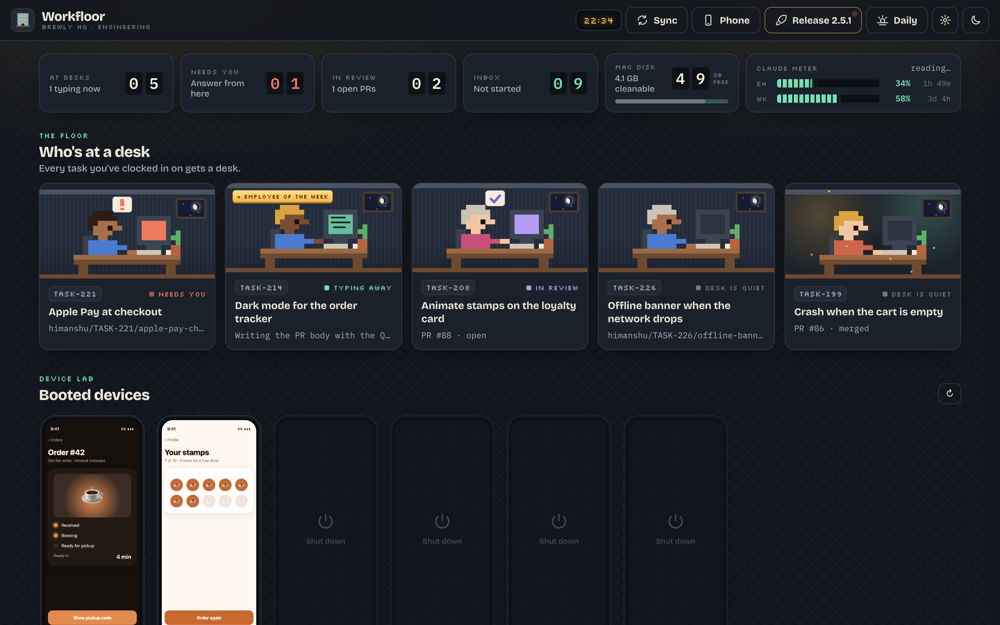
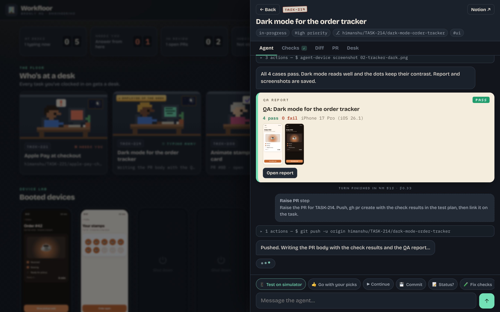
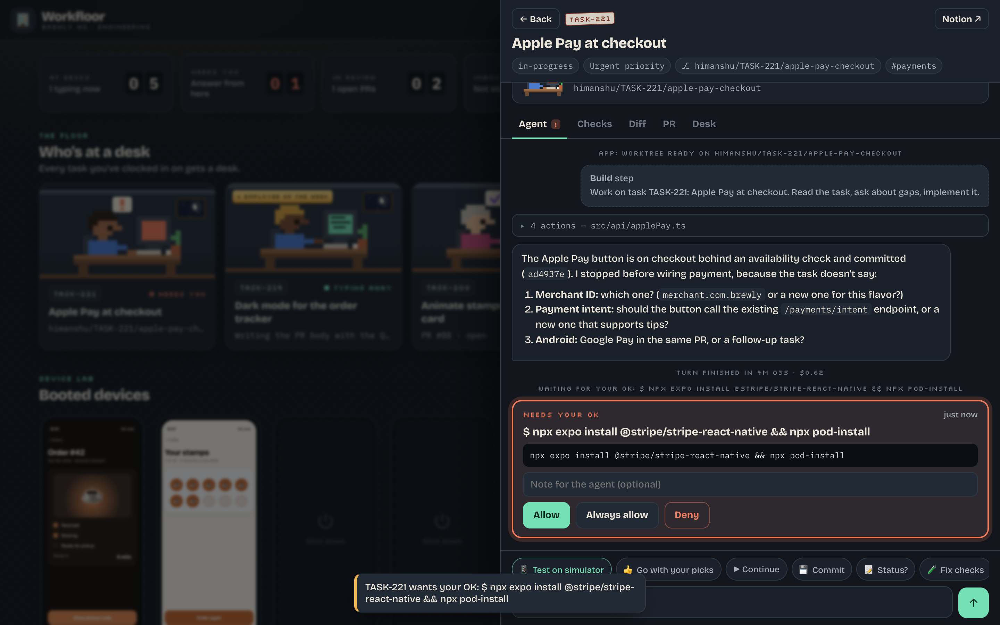
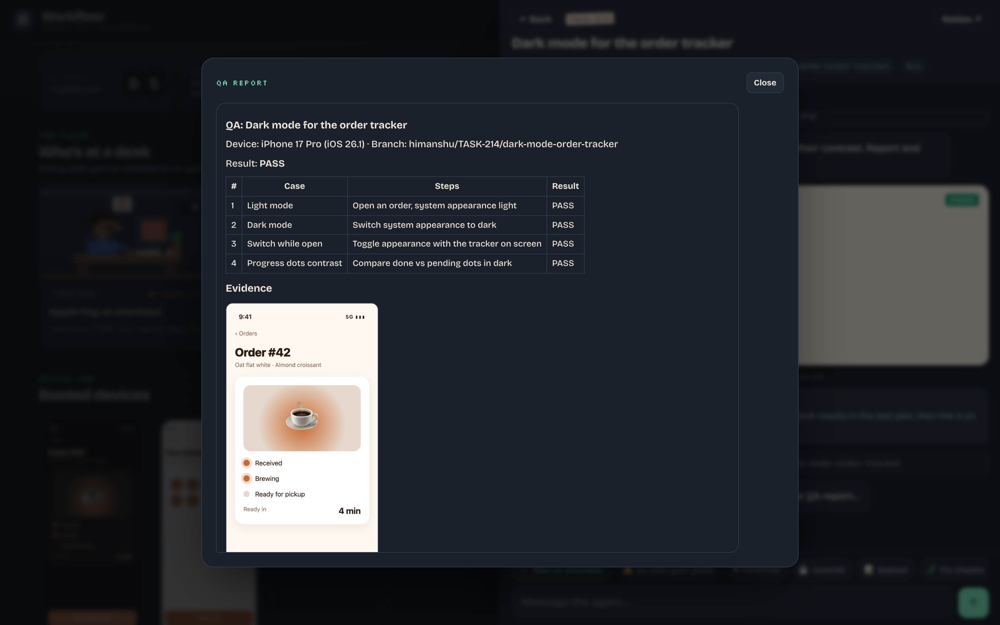
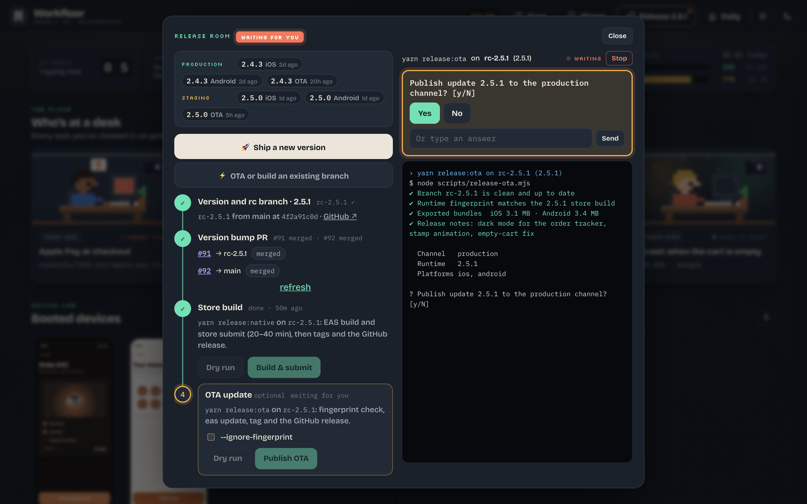

# Workfloor

**A pixel office where Claude Code agents work through your task board.**

Every task you clock in on gets a desk, its own git worktree and its own headless Claude Code agent.
You watch the whole floor at a glance, answer agents with one tap (from your phone too), and take a
task from "assigned to you" to "merged and shipped" without leaving the page.



> The screenshots use a made-up demo app, "Brewly".

## What it does

- **A desk per task.** Clock in on a Notion task and Workfloor makes a git worktree on a fresh branch,
  so several agents work in parallel without touching your main checkout.
- **The whole workflow, one conversation.** Build → checks → self review → simulator test → PR →
  CI and review comments. Every step is a `claude -p --resume` turn in the same session.
- **Your moves.** One list of everything waiting on you (a question, an approval, failing CI, a PR
  ready to merge), each with a one-tap button. Board cards say what happens next.
- **Approvals anywhere.** Risky commands wait for your OK through a small MCP permission tool. Allow
  or deny on the page, or from a push notification on your lock screen.
- **Tap-to-answer.** When an agent ends with numbered questions, each gets Yes/No or option buttons.
- **Simulator QA with evidence.** The agent drives the iOS simulator and writes a pass/fail report
  with screenshots. A device lab shows booted simulators and emulators with live screens.
- **Smarter checks.** Type errors only fail when they're in files you changed; a test runner that
  can't start is reported as skipped, not failed.
- **Merge, finish, ship.** Merge every PR from the task page, then Finish clocks out and marks the
  task done. A Ship station and a "Ready to ship" column follow it until a release carries it.
- **A release room** for React Native / Expo apps: rc branch, version bump PRs, store build and OTA
  scripts run in a real terminal with one-tap answers to their prompts, and "what's live" from your
  GitHub releases. Each release records which tasks it carried.
- **Daily.** A standup and an end-of-day checkout written for you (optionally posted to a Discord
  webhook), plus creating Notion tasks without leaving the floor.
- **Looks after you.** A Claude usage meter, a Mac disk cleaner, sounds and a voice ("Desk 42 needs
  you"), quiet hours, keyboard shortcuts and a ⌘K quick jump.
- **Phone-ready.** Pair your phone with a QR code; a Cloudflare tunnel works outside your Wi-Fi.

| | |
|---|---|
|  |  |
|  |  |

## Install

### The Mac app

1. Download `Workfloor-<version>.dmg` from [Releases](https://github.com/iamxicor/workfloor/releases),
   open it and drag **Workfloor** into **Applications**.
2. The app isn't notarized yet, so the first time macOS can't check it: right-click Workfloor →
   **Open** → **Open**, or run `xattr -dr com.apple.quarantine /Applications/Workfloor.app` once.
3. Setup opens on first launch:
   - **You:** your name (Workfloor greets you with it) and who reads your daily checkout.
   - **Tools:** checks Git, Claude Code, GitHub CLI, Homebrew, npm, Xcode, CocoaPods, Watchman, EAS,
     agent-device and more. Missing tools install with one click; sign-ins open in Terminal.
   - **Notion:** paste an integration token, or use the Notion connector in your Claude account. Pick
     your task database; Workfloor matches the fields (title, ID, status, assignee…) and you correct
     anything it got wrong.
   - **Repos:** pick your git repos. Workfloor reads the base branch, package manager and checks, and
     spots iOS/Expo apps (simulator tests) and release scripts (release room).

Your config and data live in `~/Library/Application Support/Workfloor`.
**Settings → Run setup again** changes any of it.

### From source

```bash
git clone https://github.com/iamxicor/workfloor.git
cd workfloor
npm start          # http://localhost:4747, the setup wizard opens on first run
npm run app        # builds dist/Workfloor.app and the DMG (macOS, needs Xcode command line tools)
```

No dependencies to install: it's plain Node 20+, one `server.js` and a static page.

## Requirements

- macOS (the Mac app, simulators and the `say` voice are macOS-only; the server itself runs anywhere Node does)
- [Claude Code](https://claude.com/claude-code), signed in
- Git and the [GitHub CLI](https://cli.github.com), signed in
- A Notion database of tasks
- For iOS/Expo work: Xcode, CocoaPods, Watchman, EAS CLI and [agent-device](https://www.npmjs.com/package/agent-device)

## Configuration

Setup writes `workfloor.config.json` (see [`workfloor.config.example.json`](workfloor.config.example.json)).
Everything it asks can also be edited there:

| Key | What it does |
|---|---|
| `repos` | Each repo's `path`, `base` branch and `checks` (`{changed:ts,tsx}` becomes the changed files). |
| `workflow` | The stations and the prompt each one sends the agent. `{taskId}`, `{url}`, `{branch}`, `{base}`, `{checksSummary}`… are filled in. |
| `notion.props` | Which database property is the title, ID, status, priority, tags and due date. |
| `notion.stages` | Optional: which status values mean to do / doing / review / blocked / done. Guessed when unset. |
| `notion.hideStatuses` | Statuses that keep a task off the board. |
| `notion.checkin` | Optional `{ "prop": "Category", "value": "check-in-topic" }` to turn on check-in topics. |
| `notion.audience` | Optional labels for an audience field, used in the checkout ("all users", "beta"…). |
| `featureFlags` | Optional `{ "file": "src/flags.ts", "name": "LaunchDarkly flag" }` so the checkout names the flags a task touches. |
| `release` | The release room: `repo`, `versionFile`, `versionVar`, `runner`, `tagPattern`, `oddPatchIsProduction`. |
| `agent` | Default `model` and `permissionMode` for the agents. |

Notion syncs through the API when a token is set (fast), otherwise through a headless Claude with your
Notion connector (about a minute). It re-syncs when the list is over an hour old.

## How it works

- **Server:** `server.js`, Node with zero dependencies. Server-sent events keep every open page live.
- **Agents:** `claude -p --output-format stream-json --resume <session>` per task, in its worktree.
- **Approvals:** [`mcp/approve.js`](mcp/approve.js), a tiny MCP server used as Claude Code's
  `--permission-prompt-tool`, long-polls the page for your answer.
- **Tools:** `git` worktrees, `gh` for PRs, CI and releases, `xcrun simctl` / `adb` / `devicectl` for
  devices, ntfy for push, `say` for the voice.
- **Mac app:** [`mac/Workfloor.swift`](mac/Workfloor.swift), a small AppKit + WKWebView window that runs the
  bundled server, with a Dock badge, Open at Login and a native folder picker for setup.

## Privacy and safety

Workfloor runs on your Mac and talks to Notion, GitHub and Claude with your own accounts. Pages on
other devices need the pairing token from the QR code. Push actions use signed, single-use, expiring
links. Notion tokens are stored in your data folder with owner-only permissions.

Agents run with the permission mode you choose (`auto` by default). Use `default` on a task if you
want an approval for every risky command.

## Contributing

Issues and pull requests are welcome. Keep it dependency-free and match the surrounding code.

## License

[MIT](LICENSE)

Built with [Claude Code](https://claude.com/claude-code), mostly from inside Workfloor itself.
